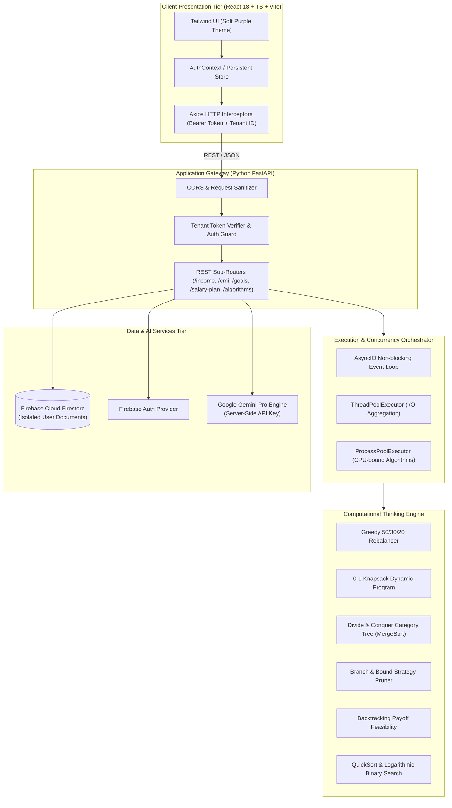

<div align="center">

# 💸 SalaryFlow
### *Algorithmic Personal Finance Engine & AI Salary Allocation Platform*

[](https://fastapi.tiangolo.com)
[](https://www.python.org/)
[](https://react.dev/)
[](https://www.typescriptlang.org/)
[](https://vitejs.dev/)
[](https://tailwindcss.com/)
[](https://firebase.google.com/)
[](https://ai.google.dev/)
[](https://github.com)
[](https://github.com)

<p align="center">
  <b>A production-grade, mathematically grounded salary planning and wealth optimization system.</b><br>
  Powered by classical computational thinking algorithms, asynchronous micro-services, and conversational Gemini AI.
</p>

[Architecture](#-system-architecture) • [Algorithms](#-computational-thinking-engine) • [Tech Stack](#-technology-stack) • [Setup & Installation](#-quickstart) • [Testing Suite](#-testing--verification)

---

</div>

## 📌 Executive Summary

**SalaryFlow** bridges the gap between raw budgeting tracking and mathematically verified financial decision-making. Unlike traditional static spreadsheet trackers or demo apps populated with synthetic mocks, SalaryFlow:

- Operates with a **Strict Zero-Fake-Data Policy** — starts with a clean ledger and computes on empirical user inputs.
- Implements a suite of **7 Classical Computational Thinking Algorithms** to solve real-world trade-offs between debt amortisation, non-discretionary commitments, liquidity preservation, and discrete goal funding.
- Leverages an **isolated backend AI orchestration layer** using Google's Gemini SDK, keeping secrets and heuristic prompts strictly guarded on the server.
- Built for real-world resilience with **multi-tenant Firestore security**, **graceful offline/fallback authentication**, and **concurrent task offloading**.

---

## 🏛 System Architecture

SalaryFlow is structured as a decoupled, multi-tier system with end-to-end type safety:



---

## 🔬 Computational Thinking Engine

The core computational decisions are modeled using rigorous algorithms with formal asymptotic time and space guarantees:

| Paradigm | Module | Business Domain / Problem Solved | Time Complexity | Space Complexity |
| :--- | :--- | :--- | :--- | :--- |
| **Greedy Heuristic** | `algorithms/greedy.py` | **Dynamic 50/30/20 Budgeting**: Evaluates income vs obligations. Automatically compresses wants to protect emergency cash flows when fixed costs exceed 50%. | $\mathcal{O}(N)$ | $\mathcal{O}(1)$ |
| **Dynamic Programming** | `algorithms/dynamic_programming.py` | **0-1 Knapsack Goal Maximization**: Formulates goals as discrete items with cost (weight) and priority (utility) to maximize cumulative life-value within monthly surplus. | $\mathcal{O}(N \cdot W)$ | $\mathcal{O}(N \cdot W)$ |
| **Divide & Conquer** | `algorithms/divide_conquer.py` | **Hierarchical Expense Decomposition**: Recursively partitions transactions into tree structures (`Needs` $\to$ `Wants` $\to$ `Investments`) and sorts using stable Merge Sort. | $\mathcal{O}(N \log N)$ | $\mathcal{O}(N)$ |
| **Backtracking** | `algorithms/backtracking.py` | **Debt Amortisation Feasibility**: Explores permutations of loan acceleration orderings, pruning branches that breach minimum cash liquidity thresholds. | $\mathcal{O}(2^N)$ | $\mathcal{O}(N)$ |
| **Branch & Bound** | `algorithms/branch_bound.py` | **Multi-Objective Strategy Selection**: Evaluates savings vs debt reduction portfolios by bounding suboptimal utility paths early in the state space. | $\mathcal{O}(2^N)$ *(pruned)* | $\mathcal{O}(N)$ |
| **QuickSort** | `algorithms/sorting.py` | **Transaction Rank Ordering**: In-place randomized pivot partitioning for high-throughput expense priority ordering. | $\mathcal{O}(N \log N)$ | $\mathcal{O}(\log N)$ |
| **Binary Search** | `algorithms/searching.py` | **Tax Bracket & Tier Classification**: Logarithmic boundary search over ascending fiscal health thresholds and marginal tax brackets. | $\mathcal{O}(\log N)$ | $\mathcal{O}(1)$ |

---

## 🛠 Technology Stack

### Frontend Application
- **Runtime & Tooling:** Node.js, Vite 5, TypeScript 5 (Strict Mode)
- **UI Framework:** React 18, React Router v6
- **Styling & Assets:** Tailwind CSS, Lucide React Icons
- **Design System:** Bespoke *Soft Purple* Palette (`#EDE9FE` Background, `#7C3AED` Primary, `#2E1065` Contrast Text, `#059669` Emerald Inflows, `#E11D48` Rose Outflows)
- **Client Networking:** Axios client with automated Firebase Auth bearer token injection and session recovery.

### Backend & Computing Core
- **Framework:** FastAPI with Python 3.11+
- **Data Validation & Serialization:** Pydantic v2 (Strict Schema Enforcement)
- **Concurrency:** Python `asyncio`, `concurrent.futures.ThreadPoolExecutor`, `concurrent.futures.ProcessPoolExecutor`
- **Functional & Metaprogramming:** Custom execution `@timing_decorator`, LRU caches, and streaming generators.

### Infrastructure & Cloud
- **Identity & Access Management:** Firebase Authentication with client offline-tolerant fallback sessions.
- **Database:** Firebase Cloud Firestore (NoSQL document store with strict per-tenant scoping `users/{uid}/*`).
- **Intelligence:** Google Gemini Generative AI SDK (Secure server-side API integration).

---

## 🚀 Quickstart

### Prerequisites
- Python 3.11 or higher
- Node.js 18+ & npm
- Git

### 1. Repository Clone
```bash
git clone https://github.com/YOUR_USERNAME/salary-flow.git
cd salary-flow
```

### 2. Backend Environment Setup
```bash
# Navigate to backend root (or run from project root)
python -m venv venv

# Activate Virtual Environment:
# On Windows (PowerShell):
.\venv\Scripts\Activate.ps1
# On macOS / Linux:
source venv/bin/activate

# Install backend dependencies
pip install -r backend/requirements.txt
```

Create a `.env` file in `backend/` (or copy from `.env.example`):
```env
GEMINI_API_KEY=your_gemini_api_key_here
FIREBASE_PROJECT_ID=smart-salary-planner
ENVIRONMENT=development
```

Start the FastAPI ASGI server:
```bash
uvicorn backend.app.main:app --reload --port 8000
```
- API Documentation: [http://localhost:8000/docs](http://localhost:8000/docs) (Swagger UI)
- Alternate Schema: [http://localhost:8000/redoc](http://localhost:8000/redoc)

---

### 3. Frontend Setup
```bash
cd frontend

# Install dependencies
npm install

# Build & Run Development Server
npm run dev
```
Open [http://localhost:5173](http://localhost:5173) in your browser.

---

## 🧪 Testing & Verification

The codebase includes an enterprise-grade test suite covering algorithmic invariants, property-based verification, and API integration flows:

```bash
# Execute complete backend test suite with coverage report
python -m pytest backend/tests --cov=backend/app --cov-report=term-missing
```

### Test Suite Composition:
- **Unit Tests (`tests/unit/`):** Exhaustive boundary validation of each algorithm (0-1 Knapsack, Greedy, MergeSort, QuickSort, EMI calculations).
- **Property-Based Testing (`tests/property/`):** Powered by **Hypothesis** to prove fundamental financial laws across thousands of randomly generated portfolios:
  $$\text{Needs} + \text{Wants} + \text{Savings} = \text{Net Income}$$
- **Integration Tests (`tests/integration/`):** FastAPI `TestClient` routes with mocked database repositories.
- **E2E Workflow Tests (`tests/e2e/`):** Full life-cycle verification from income entry to AI advisory report generation.

```text
============================= test session starts =============================
collected 27 items

backend/tests/e2e/test_e2e_workflow.py .                                 [  3%]
backend/tests/integration/test_api.py ....                               [ 18%]
backend/tests/property/test_properties.py ...                            [ 29%]
backend/tests/unit/test_algorithms.py ........                           [ 59%]
backend/tests/unit/test_core_and_concurrency.py ........                 [ 88%]
backend/tests/unit/test_emi.py ...                                       [100%]

======================= 27 passed, 1 warning in 14.38s ========================
TOTAL COVERAGE: 80%
```

---

## 🔒 Security & Privacy

1. **Defense-in-Depth Credentials:** Client application bundles never receive or reference the `GEMINI_API_KEY` or service-account credentials.
2. **Multi-Tenant User Isolation:** Firestore read/write operations require valid `uid` scoping. Users cannot traverse or read neighboring portfolios.
3. **Graceful Authentication Fallback:** In disconnected development environments without Firebase cloud keys, the client safely generates an isolated in-memory/localStorage session without throwing uncaught runtime exceptions.

---

## 📄 License & Disclaimer

Distributed under the **MIT License**.

> **Disclaimer:** *SalaryFlow is an algorithmic simulation and decision-support system designed for educational and planning purposes. It does not constitute certified financial or investment advice.*
