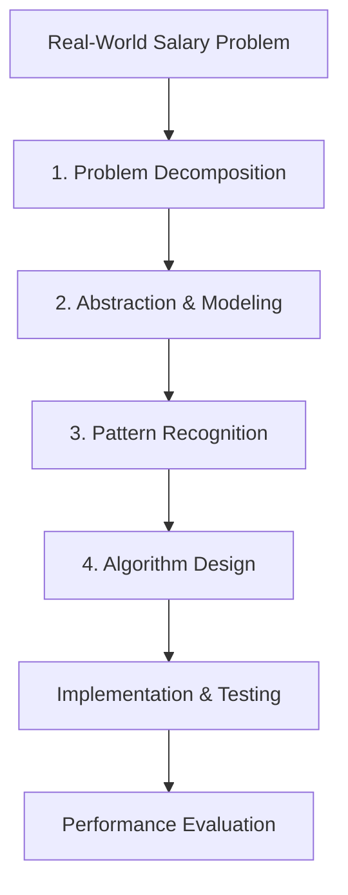

# Computational Thinking in Smart Salary Planner

Smart Salary Planner applies the four core pillars of Computational Thinking:

## 1. Problem Decomposition
The complex monthly financial planning challenge is decomposed into 11 independent modules:
1. **Authentication**: Secure Firebase user identification and session isolation.
2. **Income Aggregation**: Gathering and validating all monthly revenue streams.
3. **EMI Compound Math**: Computing deterministic monthly loan payments via $P \cdot r \cdot (1+r)^n / ((1+r)^n - 1)$.
4. **Household Expenditure**: Tracking mandatory living costs.
5. **General Expense Classification**: Sorting discretionary and non-discretionary expenses.
6. **Savings Progress Calculation**: Evaluating required monthly contributions toward target dates.
7. **Investment Tracking**: Recording equity, mutual fund, and fixed deposit contributions.
8. **Goal Allocation Optimization**: Formulating goal selection as a 0-1 Knapsack problem.
9. **Salary Surplus/Deficit Evaluation**: Executing Greedy allocation priority rules.
10. **Deficit Reduction Search**: Applying Branch and Bound optimization when expenses exceed income.
11. **AI Personalization**: Translating mathematical allocations into natural-language recommendations using Gemini.

## 2. Abstraction
Abstract domain models isolate core business logic from database and UI logic:
- `FinancialRecord` (Abstract Base Class)
- `Income`, `EMI`, `HouseholdExpense`, `Expense`, `Saving`, `Investment`, `Entertainment`, `FinancialGoal`
- `SalaryPlan`
- `SalaryAllocationStrategy` (Abstract Strategy Interface)

## 3. Pattern Recognition
Identifies patterns in user financial data:
- High EMI burden ($>30\%$ of income)
- Zero savings contribution
- Deficit spending ($B < 0$)
- Goal shortfall vs target deadline

## 4. Algorithm Selection
- **Greedy**: Priority allocation of necessity buckets.
- **Dynamic Programming**: Bounded 0-1 goal knapsack optimization.
- **Divide & Conquer**: Recursive Merge Sort & Category Tree.
- **Backtracking**: Discretionary combination search.
- **Branch & Bound**: Deficit reduction optimization.
